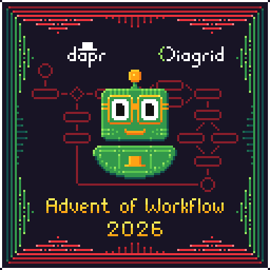

# Advent of Workflow: leaderboard

Standings and submissions for [Advent of Workflow](https://diagrid.io/advent-of-workflow), twelve Dapr Workflow challenges run by [Diagrid](https://www.diagrid.io) and open to everyone! The challenges live in [`diagrid-labs/advent-of-workflow`](https://github.com/diagrid-labs/advent-of-workflow). This repo is where you submit and where the standings live.

Challenges drop on 1, 3, 5, 7, 9, 11, 13, 15, 17, 19, 21 and 23 December 2026. Submissions close **Sunday 3 January 2027, 23:59 CET**. Results are announced **Wednesday 13 January 2027**.

North Pole Station has run on TINSEL — Tracking, Inventory, Scheduling and Elf Logistics — since 1957, and the old mainframe is finally failing: it drops jobs halfway through and keeps no record that they ever started. It cannot be taken down for repair, because the launch window does not move. So the station is being rebuilt one subsystem at a time, as durable workflows, and that is what each challenge asks you to build. Read the full story [here](STORY.md).

## Standings

Rank is the number of challenges passed, and nothing else. Participants with the same number of passes share a rank and are listed alphabetically.

<!-- STANDINGS:START -->
| Rank | Handle | Passes | Passed challenges | Diagrid runs |
|---|---|---|---|---|
| EXAMPLE | `example-handle` (not a real participant, format only) | 3 | [1](#) [3](#) [5](#) | 1 |
<!-- STANDINGS:END -->

How to read it:

- **Passes**: challenges whose submission issue is labelled `pass`.
- **Passed challenges**: one link per passed challenge, to that challenge's submission issue.
- **Diagrid runs**: how many of the passed challenges also did the optional Diagrid step, with the evidence confirmed by the reviewer. It never affects the order: a Diagrid run earns no extra pass and cannot lift anyone above a participant with more passes. This is the column the two LEGO® Game Boy™ sets are decided on.

A maintainer regenerates the table from the submission issues. Do not edit it in a pull request.

## How to submit

A submission is **an issue in this repo**, not a pull request. You need your work in a public repo, a screenshot, and the output your workflow returned. Setup is described in the [challenge repo](https://github.com/diagrid-labs/advent-of-workflow).

1. Open the [submission form](https://github.com/diagrid-labs/advent-of-workflow-leaderboard/issues/new?template=submission.yml).
2. Fill in the challenge number, link your work, drag the screenshot into the screenshot box, and paste your workflow's output, including the numbers the challenge asks for. Add the optional Diagrid screenshot if you did the bonus step.
3. Submit the issue. The reviewer takes it from there.

**One issue per challenge.** Open a separate issue for each challenge you submit. Gaps are fine: do challenge 7 before challenge 1 if you like.

Submissions are matched to your registration on your GitHub handle, so register with the same handle you submit from. A submission from a handle that did not register is still accepted, and we will follow up. Your email address stays with your registration: never put it in an issue here, which is public and permanent.

### Link to your work

Your fork of [`diagrid-labs/advent-of-workflow`](https://github.com/diagrid-labs/advent-of-workflow), with one directory or branch per challenge. It must be **public** so the reviewer can read it, and it must stay public until results are announced on 13 January 2027. Link the directory or branch holding this challenge's app, not just the repo root.

### Evidence

The screenshot is the workflow run detail page in the Dapr Dev Dashboard for a Dapr OSS run, or the workflow diagram showing the activities in the Diagrid web console for a Diagrid run. Attach it to your submission issue by dragging the image into the screenshot box, so the evidence stays with the submission.

### Issues are the only thing you open here

The submission form is the only issue anyone can open in this repo, and participants do not open pull requests here. A pull request from a participant is closed with a pointer back to the submission form. Questions do not go in issues in either repo. Ask them in the **advent-of-workflow** forum channel on the [Dapr Discord](https://discord.gg/VjzDF7H5jV), which has a topic per challenge. Everything about rules, prizes and registration is on the [landing page](https://diagrid.io/advent-of-workflow) and in [The rules](#the-rules) below.

## Review

A reviewing agent checks the numbers in your workflow output, reads the repo you linked and your screenshot, and reports against the challenge's stated criteria. The maintainer ([@marcduiker](https://github.com/marcduiker)) confirms every verdict. Neither `dapr-skills` nor Diagrid is part of the pass criteria: a hand-built workflow running on Dapr OSS passes on the same terms as anything else.

The verdict is recorded as a label on your issue and as a comment explaining it:

- **`pass`** — the issue is closed and the standings are updated.
- **`fail`** — the issue stays **open**, labelled `fail`, with a comment saying what is missing.

**Resubmitting after a fail:** do not open a new issue. Fix your work and add a comment to the same issue saying it is ready for another look. The reviewer removes the `fail` label, sets `pending` again and re-reviews. You get **one** resubmission per challenge, and it has to arrive before submissions close on 3 January 2027, 23:59 CET. Nothing is accepted after that.

- **Review turnaround:** 1 day, or 1 working day between 24 December 2026 and 3 January 2027
- **Limit on resubmissions per challenge:** 1 resubmission per challenge

## Prizes

- A digital **[Holopin](https://www.holopin.io/)** award for passing all twelve challenges. You can earn it on Dapr OSS alone.

  

- Two **LEGO Game Boy** sets: These are awarded to whoever ran the most optional steps in the challenges that use Diagrid. If more than two participants have the same amount of Diagrid-based implementations, two random winners will be chosen from this group.

> Diagrid staff and Dapr maintainers are excluded from prizes. The age and shipping restrictions on the LEGO® Game Boy™ sets are in [The rules](#the-rules) below.
>
> LEGO® is a trademark of the LEGO Group. Game Boy™ is a trademark of Nintendo. Neither sponsors, endorses or is connected with Advent of Workflow.

## The rules

Everything that decides a pass, a rank and a prize. The same rules are on the
[landing page](https://diagrid.io/advent-of-workflow).

### Taking part

- Open to everyone. Registration asks for your email, your GitHub handle and where you are with Dapr.
- **To earn the badge**, everything runs on open source Dapr on your own machine. No Diagrid account is needed, and no account of any kind.
- **To enter the draw for the two LEGO® Game Boy™ sets**, a free Diagrid account is required. The draw is decided on the optional Diagrid runs, and those cannot be done without one.
- Build by hand or with an AI agent, in any language Dapr Workflow supports. Neither `dapr-skills` nor Diagrid is part of the pass criteria: a hand-built workflow on open source Dapr passes on identical terms.
- You can start late. Your rank is how many challenges you pass, not when you started.

### Submissions and review

- One submission issue per challenge, in this repo, never a pull request.
- Your evidence is a screenshot: the workflow run detail page in the Dev Dashboard for an open source Dapr run, or the workflow diagram in the Diagrid console for a Diagrid run.
- Reviews land within a day, or within a working day between 24 December 2026 and 3 January 2027.
- A fail leaves your issue open with a comment saying what is missing. You get one resubmission per challenge, by commenting on that same issue.
- Submissions close Sunday 3 January 2027, 23:59 CET, and nothing is accepted after that. Results are announced Wednesday 13 January 2027.

### Prizes

- The Holopin award goes to everyone who passes all twelve challenges. It is digital, it never needs Diagrid, and it carries no age or shipping restriction.
- The two LEGO® Game Boy™ sets go to the participants who ran the most optional Diagrid steps. If more than two participants tie, two winners are drawn at random from that group.
- Diagrid staff and Dapr maintainers are excluded from prizes.
- You must be 18 or over on the closing date, Sunday 3 January 2027, to receive a LEGO® Game Boy™ set.
- A set cannot be shipped to a country that the United States or the European Union restricts trade or shipping with, and the giveaway is void where prohibited by law. A set that cannot be delivered under these rules goes to the next eligible participant on the same criteria.

## Community

Be kind. This project follows the [Code of Conduct](CODE_OF_CONDUCT.md). The repo name carries no year on purpose, so a future run can reuse it.

Come and build along in **#advent-of-workflow** on the [Dapr Discord](https://discord.gg/VjzDF7H5jV).
